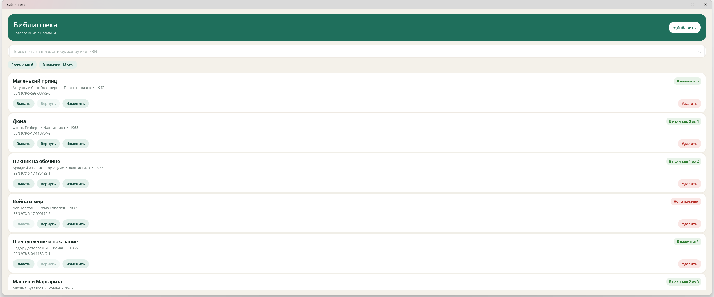
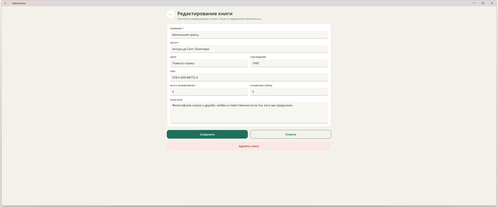

# 📚 Библиотека — приложение .NET MAUI

Простое CRUD-приложение для учёта книжного фонда. Показывает книги в наличии, позволяет искать их, добавлять, редактировать и удалять, а также выдавать и возвращать экземпляры. Данные хранятся локально в базе SQLite.

| Каталог книг | Карточка книги |
| --- | --- |
|  |  |

## Возможности

- 📖 Список книг с автором, жанром, годом издания и ISBN;
- 🔎 Поиск по названию, автору, жанру и ISBN;
- ➕ Добавление новой книги;
- ✏️ Редактирование карточки книги;
- 🗑️ Удаление с подтверждением;
- 📦 Выдача и возврат экземпляров (счётчик «в наличии»);
- 🟢 Наглядный статус: «В наличии» / «Нет в наличии»;
- 🌱 При первом запуске база заполняется шестью книгами-примерами.

## Технологии

- .NET 10 / .NET MAUI (Windows)
- SQLite через [sqlite-net-pcl](https://github.com/praeclarum/sqlite-net)
- Shell-навигация, XAML + code-behind

## Запуск

Нужен .NET SDK 10 и рабочая нагрузка MAUI для Windows:

```powershell
dotnet workload install maui-windows
```

Сборка и запуск:

```powershell
dotnet build LibraryApp\LibraryApp.csproj -f net10.0-windows10.0.19041.0
dotnet run --project LibraryApp -f net10.0-windows10.0.19041.0
```

Или откройте `LibraryApp.sln` в Visual Studio и нажмите F5.

## Где находится база данных

Файл `library.db3` создаётся в папке данных приложения:

```csharp
Path.Combine(FileSystem.AppDataDirectory, "library.db3")
```

На Windows это `%LOCALAPPDATA%\<имя пользователя>\com.companyname.libraryapp\Data\library.db3`.

Чтобы сбросить данные и заново получить демонстрационный набор книг — удалите файл базы и запустите приложение снова.

## Структура проекта

```
LibraryApp/
├── Models/
│   └── Book.cs              # модель книги и вычисляемые свойства
├── Data/
│   └── BookDatabase.cs      # инициализация SQLite, CRUD, выдача/возврат, демо-данные
├── Views/
│   ├── BooksPage.xaml       # каталог: поиск, список, действия
│   ├── BooksPage.xaml.cs
│   ├── BookEditPage.xaml    # форма добавления/редактирования
│   └── BookEditPage.xaml.cs
├── Resources/Styles/
│   ├── Colors.xaml          # палитра приложения
│   └── Styles.xaml          # стили контролов и карточек
├── App.xaml / App.xaml.cs   # единый экземпляр BookDatabase
├── AppShell.xaml            # навигация и регистрация маршрутов
└── MauiProgram.cs           # запуск MAUI-приложения
```

## Добавить Android (по желанию)

1. Установите рабочую нагрузку: `dotnet workload install maui-android`.
2. В `LibraryApp/LibraryApp.csproj` добавьте целевую платформу:

```xml
<TargetFrameworks>net10.0-windows10.0.19041.0;net10.0-android</TargetFrameworks>
```

3. Соберите нужную платформу: `dotnet build LibraryApp -f net10.0-android`.
